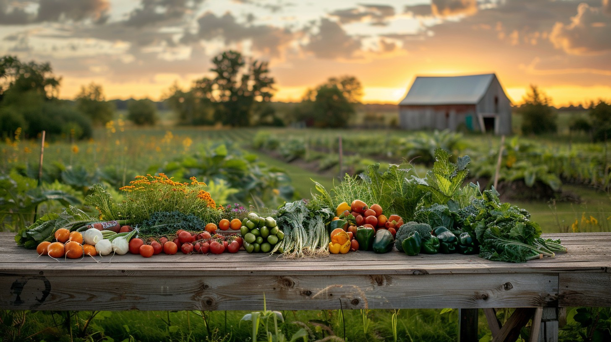

# Mäkelän Farm Shop – Moodboard

## 1. Feeling

- Fresh – represents fresh farm produce.
- Welcoming – makes customers feel comfortable.
- Natural – reflects Finnish countryside and local farming.

## 2. Colour palette

| Colour | Hex code | Use |
|---|---|---|
| Deep green | #245B55 | Header and footer |
| Orange | #E58A55 | Navigation and accents |
| Cream | #FFF8E8 | Main background |
| Dark grey | #263238 | Body text |
| Yellow | #F2C14E | Highlights |

## 3. Colour contrast accessibility

The main body text colour is **Dark grey (#263238)** on the **Cream background (#FFF8E8)**.

- Main text colour: #263238
- Background colour: #FFF8E8
- Contrast ratio: **12.44:1**
- WCAG AA requirement: 4.5:1
- Result: Passes WCAG AA accessibility requirements for normal text.

## 4. Typography

- Georgia – headings, for a traditional and friendly feeling.
- Arial – body text, for easy reading.

## 5. Reference websites

Add three reference websites from your E1 research or plan.md.

1. [Mattila Farm](https://www.mattilafarm.com/)
2. [Uotilat](https://www.uotilat.fi/english)
3. [Maatilapuoti](https://maatilapuoti.fi/en/)

## 6. Image reference

